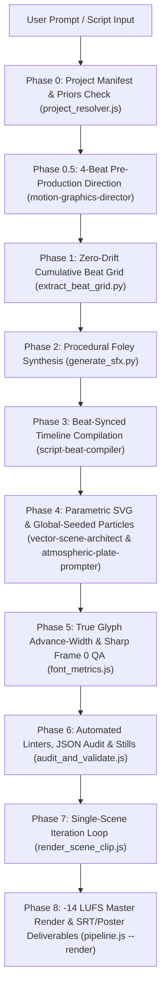

# Historical Motion Graphics Engine: `/build-historical-reel`

A programmatic 9:16 motion graphics production engine designed to transform historical events, tactical engagements, and investigative scripts into beat-quantized, cinematic documentary reels for **YouTube Shorts, Instagram Reels, and TikTok**.

Built on **React + Remotion (`1080 × 1920 @ 60 FPS`)**, the engine enforces strict documentary visual and editorial discipline: flat vector silhouettes, parametric SVG blueprints, locked canvas palettes, zero-drift beat-synced kinetic typography with true glyph advance-width measurement, automated code/visual linters, `-14 LUFS` audio mastering, and auto-generated SRT/metadata deliverables.

---

## Core Specifications & Constraints ([`config/pipeline_constants.json`](file:///c:/Users/Syed%20Obaid/Documents/motion%20reels/config/pipeline_constants.json))

| Parameter | Value / Standard | Enforcement / Purpose |
| :--- | :--- | :--- |
| **Canvas Resolution** | `1080 × 1920` (9:16 Vertical) | Standard vertical short-form format |
| **Framerate** | `60 FPS` | Fluid mechanical & particle micro-motion |
| **Duration Window** | **`2,700 – 3,500` frames** (`45.00s – 58.33s`) | Single canonical `MAX_FRAMES = 3500` retention pacing ceiling |
| **Scene Pacing** | **`2.0s – 2.8s`** (`120–168` frames; up to `180f` epilogue) | **16–29 cuts per reel**; 4-second static holds are banned |
| **Safe-Zone Profile** | Configurable via [`config/safe_zones.json`](file:///c:/Users/Syed%20Obaid/Documents/motion%20reels/config/safe_zones.json) | Default `CONSERVATIVE_UNION` + `1080×1350` (`4:5`) IG feed grid safety |
| **Text Safe Zone** | `y = 346px` to `y = 806px` (`x = 64..1016px`) | Safe from platform headers; `952px` max width |
| **Artwork Safe Zone** | `y = 864px` to `y = 1498px` (45% – 78%) | Dedicated vertical slice for parametric vector storytelling |
| **Bottom / Right Buffers** | `y > 1498px` (Bottom 22%) / `x > 918px` (Right 15%) | Cleared for platform captions, audio discs, and action stacks |
| **Typography & Fonts** | Vendored `Montserrat Black` (v31) / `Inter ExtraBold` (v20) | All-caps, `+0.04em` tracking, `>=56px` setup / `>=64px` payoff floors (`FONT_LINT`) |
| **Copy & Line Budget** | **6–10 words total**, $< 40$ chars/line, **$\le 2$ lines/layer** | Measured via real `hmtx` glyph advance widths ([`scripts/font_metrics.js`](file:///c:/Users/Syed%20Obaid/Documents/motion%20reels/scripts/font_metrics.js)) |
| **Audio Mastering** | **`-14.0 LUFS` integrated / `-1.0 dBTP`** | Automatic `-7.5 dB` BGM impact ducking + `-2f` perceptual SFX lead bias |

---

## End-to-End Execution Pipeline ([`scripts/pipeline.js`](file:///c:/Users/Syed%20Obaid/Documents/motion%20reels/scripts/pipeline.js))



---

## Key Architectural Guarantees

### 1. Zero-Cumulative-Drift Beat Grid & Beat-Synced Typography
- [`extract_beat_grid.py`](file:///c:/Users/Syed%20Obaid/Documents/motion%20reels/.agents/skills/build-historical-reel/scripts/extract_beat_grid.py) computes cumulative beat timestamps in floating point (`t = beat_idx * (60.0 / bpm)`) and rounds once to absolute integer frames (`round(t * 60)`), preventing cumulative rounding drift across bars.
- Instead of hardcoding Frame `30` on every scene, the Red Payoff Line's `triggerFrameOffset` snaps to the first detected beat in `[18, 45]` frames (`0.30s–0.75s`) after `scene.startFrame`.
- Transient SFX (`sub_boom.wav`, `stamp_slam.wav`) are automatically biased **2 frames early (`~33ms`)** so audio leads visual impacts for crisp perceived synchronization.
- Global Frame `0` (Scene 1's opening frame) renders completely sharp (`blur(0px)`, `opacity: 1`) so social feed thumbnails and cover pickers never show a blurred text smear.

### 2. Global-Frame Particle Seeding
- [`AtmosphericBackground.tsx`](file:///c:/Users/Syed%20Obaid/Documents/motion%20reels/src/components/AtmosphericBackground.tsx) seeds all particles deterministically using a Mulberry32 PRNG keyed by `(emitterType, particleId)` and evaluates positions at `globalFrame = scene.startFrame + localFrame`.
- Isolated single-scene clips (`render_scene_clip.js`) and full master renders reproduce the exact same unbroken particle field across cuts.

### 3. Seven Modular Scene Archetypes & Proportional Five-Act Arc
- **Seven Core Archetypes**: `LONE_LEADER`, `CROWD_TALLY`, `VEHICLE_IN_TRANSIT`, `STRUCTURAL_FRACTURE`, `VECTOR_MAP`, `SPLIT_CONFRONTATION`, and **`QUOTE_CARD`** (primary-source intercept/telegram/diary reveal with source attribution pill and live waveform micro-motion).
- **Proportional Five-Act Structure**: Hook (`0–7%`), Inciting Crisis (`7–30%`), Escalating Crucible (`30–65%`), Turning Point (`65–85%`), Symmetric Resolution & Seamless Loop/CTA (`85–100%`).
- **Editorial Citations & Sensitivity Mode**: Numeric claims carry `claim: { text, source, url, verified }` metadata; `sensitivity: "SOMBER_MEMORIAL"` replaces triumphant scale-slams with solemn slow-fade reveals on mass-casualty scenes.

### 4. Automated Code & Timeline Linters ([`scripts/audit_and_validate.js`](file:///c:/Users/Syed%20Obaid/Documents/motion%20reels/scripts/audit_and_validate.js))
Every rule is enforced automatically and emitted as structured JSON (`projects/<slug>/audit/audit_report.json`):
- `DURATION_CEILING`: Enforces `2,700 <= totalFrames <= 3,500`.
- `GLYPH_WIDTH_AND_LINE_CAP`: Measures real `hmtx` glyph advance widths for `Montserrat Black` / `Inter ExtraBold` (with `1.02em` CJK support), enforcing $\le 2$ lines per layer inside `952px`.
- `BEAT_SYNC_PAYOFF`: Verifies payoff offsets align with the musical beat grid (auto-repaired with `--auto-fix`).
- `CAMERA_DISCIPLINE_LINT`: Prohibits `SNAP_ZOOM` and `CRASH_ZOOM`.
- `FONT_LINT`: Flags banned fonts (`Caveat`, `Courier Prime`, etc.).
- `PHOTO_PASTE_LINT`: Flags raw `` / `<Image>` / `<image>` tags inside parametric vector components.
- `PALETTE_LINT`: Verifies locked palette compliance.
- `ARCHETYPE_ROTATION_LINT`: Flags $>2$ identical consecutive archetypes.
- `MICRO_MOTION_CHECK`: Diffs early vs. late scene frames (`--check-motion`) to ensure non-zero secondary animation.

---

## Cross-Platform CLI Reference ([`scripts/pipeline.js`](file:///c:/Users/Syed%20Obaid/Documents/motion%20reels/scripts/pipeline.js))

All commands run natively via Node.js across Windows, macOS, Linux CI, and Remotion Lambda (with `render_pipeline.ps1` maintained as a thin wrapper):

```bash
# 1. Fast Static Audit, Code Linters & Auto-Fix for a Specific Project
node scripts/pipeline.js --project aleutian-campaign-1942 --audit-stills --skip-stills --auto-fix

# 2. Full Visual Still Audit + Micro-Motion Frame-Diff + Deliverables Export
node scripts/pipeline.js --project aleutian-campaign-1942 --audit-stills --check-motion

# 3. Single-Scene Iteration Render (for fast revision loops)
node scripts/render_scene_clip.js 3 --project aleutian-campaign-1942

# 4. Auto-Emit SRT Captions, Citation Metadata & 9:16 + 4:5 Posters
node scripts/pipeline.js --project aleutian-campaign-1942 --deliverables

# 5. Update Empirical Retention Priors from Telemetry
npm run telemetry

# 6. CI Smoke Test (All Timelines + Linters + 540x960 Smoke Render)
npm run test:smoke

# 7. Full Production Export (with FFmpeg -14 LUFS Loudness Mastering)
node scripts/pipeline.js --project aleutian-campaign-1942 --render
```
