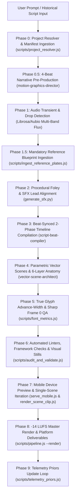
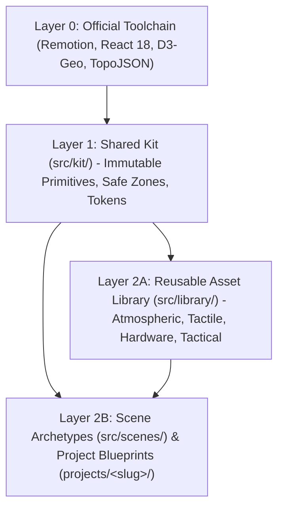

# Historical Motion Graphics Production Engine: `/build-historical-reel`

A localized, programmatic 9:16 vertical motion graphics production engine designed to compile historical events, military actions, and investigative scripts into high-retention, cinematic documentary reels for **YouTube Shorts, Instagram Reels, and TikTok**.

Built on **React + Remotion (`1080 × 1920 @ 60 FPS`)**, the engine enforces strict documentary visual discipline: tactile paper collage staging, multi-tier uniform and material hierarchies (eliminating flat monochrome voids), authentic reference blueprint ingestion, 6-layer parametric vector anatomy, audio transient onset and drop detection, true glyph advance-width tracking, automated code and framework linters, `-14 LUFS` loudness mastering, and an empirical retention priors feedback loop.

---

## 1. Core Specifications & Quality Thresholds ([`config/pipeline_constants.json`](file:///c:/Users/Syed%20Obaid/Documents/motion%20reels/config/pipeline_constants.json))

| Parameter | Standard / Value | Automated Enforcement & Retention Purpose |
| :--- | :--- | :--- |
| **Canvas Resolution** | `1080 × 1920` (9:16 Vertical) | Industry standard vertical short-form format |
| **Framerate** | `60 FPS` | Fluid mechanical, aerodynamic, and particle micro-motion |
| **Master Duration Ceiling** | **`2,700 – 3,500` frames** (`45.00s – 58.33s`) | Single canonical `MAX_FRAMES = 3500` high-retention ceiling |
| **Scene Pacing Window** | **`1.4s – 2.2s`** (`84–132` frames; up to `150f` epilogue) | **22–34 cuts per reel**; eliminates slow static holds |
| **Hook Pacing & Archetype** | **`≤ 108 frames`** (`1.8s`, target `96f` / `1.6s`) | Stops feed swipe-aways within 1.2s (`HOOK_PACING_LINT`, `HOOK_ARCHETYPE_LINT`) |
| **Dead-Hold Threshold** | **`≤ 72 frames`** (`1.2s`) | Post-payoff hold ceiling to eliminate slide-reading fatigue (`DEAD_HOLD_LINT`) |
| **Platform Safe-Zone** | Profile: `CONSERVATIVE_UNION` ([`config/safe_zones.json`](file:///c:/Users/Syed%20Obaid/Documents/motion%20reels/config/safe_zones.json)) | Guaranteed safe for Instagram `4:5` (`1080 × 1350`) feed grid crop |
| **Text Safe Zone** | `y = 346px` to `y = 806px` (18% – 42% height) | Pinned above platform headers; maximum line width `952px` |
| **Artwork Safe Zone** | `y = 864px` to `y = 1498px` (45% – 78% height) | Dedicated vertical slice for parametric vector storytelling |
| **Platform UI Buffers** | `y > 1498px` (Bottom 22%) / `x > 918px` (Right 15%) | Cleared for captions, audio discs, profile icons, and action stacks |
| **Typography & Fonts** | Vendored `Montserrat Black` (v31) / `Inter ExtraBold` (v20) | All-caps, `+0.04em` tracking, floors: **`≥ 64px` setup / `≥ 76px` payoff** (`FONT_LINT`) |
| **Copy & Word Budget** | **3–7 words total**, $< 40$ chars/line, **$\le 2$ lines/layer** | Measured via real `hmtx` glyph advance widths ([`scripts/font_metrics.js`](file:///c:/Users/Syed%20Obaid/Documents/motion%20reels/scripts/font_metrics.js)) |
| **Audio Mastering** | **`-14.0 LUFS` integrated / `-1.0 dBTP`** | Automatic `-7.5 dB` BGM impact ducking + `-2f` (`-33ms`) perceptual SFX lead |
| **Telemetry Feedback** | Empirical priors in [`config/retention_priors.json`](file:///c:/Users/Syed%20Obaid/Documents/motion%20reels/config/retention_priors.json) | Continuous feedback mapping audience hold rates back to scene archetypes |

---

## 2. End-to-End Production Pipeline ([`scripts/pipeline.js`](file:///c:/Users/Syed%20Obaid/Documents/motion%20reels/scripts/pipeline.js))



---

## 3. Core Architectural Guarantees & Visual Discipline

### 1. Dynamic Atmospheric Staging & Rich Color Variety (Peshawar Standard)
* **Context-Motivated Staging per Scene**: Prevents locking the reel into a monotonous dark void. Every scene motivates its staging style (`SUNBURST_HERO`, `PAPER_EXTERIOR`, `GRAPH_GRID`, `WOOD_PANEL`, `NIGHT_FELT`) directly from narrative context.
* **Warm & Setting-Motivated Sky Gradients**: Contrasts dark ground silhouettes with rich sky palettes (terracotta and dark umber for Middle Eastern settings; amber veld and mahogany for South Africa; vibrant dawn gold for Mediterranean countryside; deep azure for maritime operations; tactical slate-navy for maps and blueprints).
* **Tactile Paper Collage Aesthetics**: Integrates physical cardstock substrates, rotating sunburst rays, quadrille drafting grids with wood command shelves, paper-cut horizon dunes, and subtle paper grain.
* **Global-Frame Seeded Particle Layer**: Runs continuous particle emitters (`SNOW`, `ASH`, `RAIN`, `DUST`, or `NONE`) seeded deterministically via Mulberry32 PRNG keyed to `(emitterId, globalFrame)` in [`src/kit/AtmosphericBackground.tsx`](file:///c:/Users/Syed%20Obaid/Documents/motion%20reels/src/kit/AtmosphericBackground.tsx). Particles remain completely unbroken across both isolated scene clips and full master renders.

### 2. Multi-Tier Architectural, Material & Uniform Color Hierarchy
* **No Flat Monochromatic Voids**: Never reduces human figures, vehicles, or architecture to flat black blobs (`#090D12`). Deconstructs subjects into authentic historical materials and depth layers.
* **Authentic Material Palette**:
  * *Attire*: Khaki wool serge (`#3B3426`), polished brass buttons (`#F59E0B`), scarlet collar tabs (`#DC2626`), gold bullion visor chinstraps (`#FBBF24`), crimson VC ribbon (`#991B1B`), malacca cane (`#5A3E2D`), and midnight silk eyepatch (`#18181B`).
  * *Architecture & Terrain*: Sandstone masonry with mortar joints, warm terracotta stone forts, amber river currents with white foam wakes, Tuscan cypress rows, pine trench duckboards, and rusted iron barbette plating.
  * *Vehicles & Weapons*: Two-tone camouflage flying boat hulls (slate blue and RAF dark sea grey), blued-steel revolvers with walnut grips, brass shell casings, and locomotive boiler iron.
* **Atmospheric Backlighting & Depth Separation**: Soft radial backlighting, horizon glows, and rim lights separate foreground subjects from warm background skies.
* **Articulated Die-Cut Puppet Rigs**: For bureaucratic, satirical, or non-grim vignettes, the engine deploys [`<CutoutPuppet />`](file:///c:/Users/Syed%20Obaid/Documents/motion%20reels/src/library/tactile/CutoutPuppet.tsx) rigs (archival portrait heads on tactile bodies with `#F4EFE6` borders).
* **Mandatory Reference Ingestion Gate (`MANDATORY_REFERENCE_PLATE_LINT`)**:
  * Drafting SVGs from memory or guesswork without on-disk reference images is strictly prohibited. Real archival reference blueprints must be ingested into `projects/<slug>/plates/` and cataloged in `manifest.json`.
  * Every plate passes binary magic-byte verification (`0xFF 0xD8 0xFF` for JPEG, `\x89PNG` for PNG, `RIFF...WEBP` for WebP), must be $\ge 10\text{KB}$, and must contain zero HTML error pages.
  * Complies with Wikimedia step-thumbnail rules (`iiurlwidth=960` or `1280` via [`scripts/ingest_reference_plates.js`](file:///c:/Users/Syed%20Obaid/Documents/motion%20reels/scripts/ingest_reference_plates.js)).

### 3. The 6-Layer Organic Vector Anatomy Standard
Explosions, impacts, and dynamic silhouettes are constructed via the 6-layer vector hierarchy in [`src/kit/OrganicExplosion.tsx`](file:///c:/Users/Syed%20Obaid/Documents/motion%20reels/src/kit/OrganicExplosion.tsx):
1. **Layer 1: Ambient Volumetric Aura**: `<radialGradient>` aura defining illumination and lighting falloff.
2. **Layer 2: Dynamic Shockwave / Ionization Rims**: Mach rings, supersonic ozone glows, and speed lines.
3. **Layer 3: Acute Energy Spikes / Directional Vectors**: Sharp multi-color flame tongues and structural stress lines.
4. **Layer 4: Multi-Tiered Organic Body Geometry**: Nested arc-scalloped lobes or mechanical foils (raw polygons and flat blobs are banned).
5. **Layer 5: High-Contrast Core Accent**: White-hot 8-pointed core flash stars, glowing cockpit dials, or fractured structural spars.
6. **Layer 6: Detached Orbiting Micro-Elements**: Flying cloudlets, trailing propellant fragments, shrapnel shards, and embers.

### 4. Typography Discipline, Real Glyph Metrics & Sharp Frame 0
* **Three-Element Text Cap**: At most three text elements per screen: an optional top context tag, a white setup line, and a red payoff line.
* **Strict Word & Line Budget**: Combined setup and payoff text is capped at **3–7 words total** ($< 40$ chars per line, **$\le 2$ lines per layer**) for instant 0.4s comprehension.
* **True Glyph Advance-Width Tracking**: Real advance widths are measured via font `hmtx` tables in [`scripts/font_metrics.js`](file:///c:/Users/Syed%20Obaid/Documents/motion%20reels/scripts/font_metrics.js) (including CJK $1.0\text{em}$ wide glyphs) inside the $952\text{px}$ text container.
* **Sharp Frame 0 Discipline (`HOOK_PACING_LINT`, `HOOK_ARCHETYPE_LINT`, `HOOK_TYPEWRITER_LINT`)**: Global Frame 0 renders 100% sharp (`blur(0px)`, `opacity: 1`) with high-stakes conflict text so thumbnails and preview cards never blur. Scene 1 is strictly capped at **$\le 108$ frames (1.8s)** using high-hold archetypes (`SPLIT_CONFRONTATION`, `STRUCTURAL_FRACTURE`, `VEHICLE_IN_TRANSIT`). Typewriter animations on Scene 1 are banned.

### 5. Audio Transient Analysis & Perceptual Audio-Visual Sync
* **Audio Transient & Drop Detection**: Replaces static BPM grids with multi-band spectral flux analysis (Python Librosa/Aubio) detecting `BASS_DROP` (sub-bass 20–220Hz surges), `CYMBAL_CRASH` (high-band 3500–11000Hz bursts), and rhythmic `ENERGY_PEAK` events.
* **Transient-Driven Scene Shifts**: Scene transitions snap inside the `[84, 132]` frame window directly to detected musical transients.
* **2-Phase Reactive Mid-Scene Choreography**: Phase 1 (setup motion) $\rightarrow$ Phase 2 (payoff hit impulse + secondary vector state transformation on the transient hit frame).
* **Perceptual SFX Lead Bias & Automatic Ducking**: Transient SFX (`sub_boom.wav`, `stamp_slam.wav`, `artillery_shell.wav`) are biased **2 frames early (`-33ms`)** so sound leads visual impact. BGM is automatically ducked by **`-7.5 dB`** under impact slams.
* **Dead-Hold Prevention (`DEAD_HOLD_LINT`)**: Post-payoff hold must not exceed **72 frames (`≤ 1.2s`)** without secondary micro-action.

---

## 4. Three-Layer Component Architecture & Framework Governance

The codebase enforces a strict Three-Layer Component Architecture validated by [`scripts/lint_framework.js`](file:///c:/Users/Syed%20Obaid/Documents/motion%20reels/scripts/lint_framework.js):



* **Layer 0 (L0) - Toolchain**: Remotion, React 18, D3-Geo, and TopoJSON.
* **Layer 1 (L1) - Shared Kit ([`src/kit/`](file:///c:/Users/Syed%20Obaid/Documents/motion%20reels/src/kit/))**: Immutable engine primitives (`AtmosphericBackground`, `BeatGrid`, `GlyphLayer`, `OrganicExplosion`, `SafeZoneContainer`, `SFXTrigger`, `WeatheredMilitaryStamp`, `tokens.ts`). L1 components may never import from scenes or projects.
* **Layer 2 (L2) - Modular Library & Compositions ([`src/library/`](file:///c:/Users/Syed%20Obaid/Documents/motion%20reels/src/library/) & [`src/scenes/`](file:///c:/Users/Syed%20Obaid/Documents/motion%20reels/src/scenes/))**:
  * `atmospheric/`: Locked palettes and PRNG particle emitters.
  * `typography/`: Pinned [`KineticTextStack`](file:///c:/Users/Syed%20Obaid/Documents/motion%20reels/src/components/KineticTextStack.tsx) and [`PersistentHudBadge`](file:///c:/Users/Syed%20Obaid/Documents/motion%20reels/src/components/PersistentHudBadge.tsx).
  * `tactile/`: Die-cut cards, [`CutoutPuppet`](file:///c:/Users/Syed%20Obaid/Documents/motion%20reels/src/library/tactile/CutoutPuppet.tsx), and rolling counters.
  * `characters/`: Parameterized commander silhouettes and marching ranks.
  * `hardware/`: Aircraft, warships, armored vehicles, and radar dishes.
  * `tactical/`: Tactical radar sweeps, D3-geo animated map projections, and flags.
  * `scenes/`: Archetype scene wrappers with zero hardcoded business logic.

### Framework Linters ([`scripts/lint_framework.js`](file:///c:/Users/Syed%20Obaid/Documents/motion%20reels/scripts/lint_framework.js))
* `FRAMEWORK_NO_MATH_RANDOM`: Enforces deterministic PRNG seeding (Mulberry32).
* `FRAMEWORK_INTERPOLATE_CLAMP`: Enforces explicit extrapolate clamps (`{ extrapolateLeft: 'clamp', extrapolateRight: 'clamp' }`) on all Remotion `interpolate()` calls.
* `FRAMEWORK_NO_CSS_ANIMATIONS`: Flags `@keyframes` or CSS `transition` rules that break frame-by-frame rendering determinism.
* `FRAMEWORK_NO_WALL_CLOCK_TIME`: Prohibits `Date.now()`, `performance.now()`, `setTimeout`, and `setInterval`.
* `FRAMEWORK_IMPORT_CROSS_PROJECT`: Restricts projects from cross-importing other project vector assets.

---

## 5. Seven Modular Scene Archetypes

Scenes are assembled from seven core archetypes with strict rotation discipline (no more than 2 consecutive identical archetypes):

1. **`LONE_LEADER`**: Silhouette of a key historical figure with atmospheric backlighting, authentic uniform hierarchy, and singular accent prop.
2. **`CROWD_TALLY`**: Silhouette rank-and-file or casualty cluster paired with a 36-frame (0.6s) rolling integer counter.
3. **`VEHICLE_IN_TRANSIT`**: Aircraft, naval vessel, locomotive, or convoy with continuous micro-motion trails and vector propulsion.
4. **`STRUCTURAL_FRACTURE`**: Architectural facade, fortress, bunker, or aircraft sustaining impact or detonation with synchronized screen shake.
5. **`VECTOR_MAP`**: D3-geo tactical contours, water boundaries, animated vector headings, and coordinate HUD badges.
6. **`SPLIT_CONFRONTATION`**: Dual opposing silhouettes, commanders, or emblems divided along a sharp vertical or diagonal split axis.
7. **`QUOTE_CARD`**: Primary-source intercept, telegram, or diary quote reveal with source attribution pill and live audio waveform micro-motion.

---

## 6. Proportional Five-Act Micro-Arc & Editorial Standards

Reels structure history into proportional duration shares across the `2,700 – 3,500` frame envelope:
* **Act I: High-Stakes Hook (`0% – 7%`)**: Immediate life-or-death crisis; sharp Frame 0; $\le 108$ frames.
* **Act II: Inciting Crisis (`7% – 30%`)**: Operational stakes, geographical theater, initial moves.
* **Act III: Escalating Crucible (`30% – 65%`)**: Clashing forces, structural failures, casualty counters.
* **Act IV: The Turning Point (`65% – 85%`)**: Critical pivot, tactical gamble, or fatal error.
* **Act V: Resolution & Loop/CTA (`85% – 100%`)**: Strategic aftermath, historical legacy, seamless audio/visual loop.

### Editorial Integrity & Sensitivity Mode
* **Source Claims & Verification**: High-impact casualty or metric scenes attach structured `claim: { text, source, url, verified }` metadata.
* **Sensitivity Mode (`SOMBER_MEMORIAL`)**: Mass-casualty tragedies automatically disable triumphant payoff slams and aggressive screen shake, substituting solemn slow-fade reveals and subdued palettes.
* **Loudness Compliance**: Master audio exports pass FFmpeg two-pass EBU R128 normalization (`loudnorm=I=-14:TP=-1.0:LRA=11`).

---

## 7. Automated Linters Suite ([`scripts/audit_and_validate.js`](file:///c:/Users/Syed%20Obaid/Documents/motion%20reels/scripts/audit_and_validate.js))

The engine audits all projects automatically, outputting structured JSON reports to `projects/<slug>/audit/audit_report.json`:

| Lint Rule | Target / Check | Auto-Fix Support |
| :--- | :--- | :---: |
| `DURATION_CEILING` | Enforces `2,700 <= totalFrames <= 3,500` (`45.0s – 58.33s`) | ❌ Manual |
| `MANDATORY_REFERENCE_PLATE_LINT` | Validates on-disk reference blueprints with magic-byte checking | ❌ Manual |
| `STAGING_DIVERSITY_LINT` | Verifies $\ge 3$ distinct staging modes (Peshawar Standard) | ❌ Manual |
| `HOOK_ARCHETYPE_LINT` | Enforces Scene 1 archetype in `[SPLIT, FRACTURE, VEHICLE]` | ❌ Manual |
| `HOOK_PACING_LINT` | Scene 1 duration capped at $\le 108$ frames (1.8s) | ❌ Manual |
| `HOOK_TYPEWRITER_LINT` | Banned typewriter animation on Scene 1 hook | ❌ Manual |
| `SCENE_PACING_WINDOW` | Scene duration between `84–132` frames (max 150f epilogue) | ❌ Manual |
| `WORD_BUDGET` | Combined setup + payoff text between `3–7` words total | ❌ Manual |
| `GLYPH_WIDTH_AND_LINE_CAP` | Real font advance widths $\le 952\text{px}$, $\le 2$ lines per layer | ❌ Manual |
| `BEAT_SYNC_PAYOFF` | Payoff trigger snapped to musical transient in `[18, 45]` frames | ✅ `--auto-fix` |
| `DEAD_HOLD_LINT` | Post-payoff hold $\le 72$ frames ($\le 1.2$s) | ❌ Manual |
| `CAMERA_DISCIPLINE_LINT` | Bans `SNAP_ZOOM` and `CRASH_ZOOM` in favor of motivated moves | ✅ `--auto-fix` |
| `ARCHETYPE_ROTATION_LINT` | Flags $> 2$ consecutive identical scene archetypes | ❌ Manual |
| `FONT_LINT` | Enforces `Montserrat Black` or `Inter ExtraBold` (bans cursive/typewriter) | ❌ Manual |
| `PHOTO_PASTE_LINT` | Flags raw `` or photo pastes inside parametric vector scenes | ❌ Manual |
| `PALETTE_LINT` | Enforces locked palette tokens and flags hot neon debug colors | ❌ Manual |
| `MICRO_MOTION_CHECK` | Frame-diffs early vs late scene frames to verify continuous motion | ❌ Manual |
| `FRAMEWORK_LINT` | Verifies PRNG determinism, `interpolate()` clamping, and import barriers | ❌ Manual |

---

## 8. Empirical Telemetry & Retention Feedback Loop ([`scripts/telemetry_priors.js`](file:///c:/Users/Syed%20Obaid/Documents/motion%20reels/scripts/telemetry_priors.js))

The engine does not rely on static assumptions. It implements a closed telemetry feedback loop:
1. Ingests audience watch ratios and second-by-second retention curves from YouTube Studio CSVs, YouTube API JSON, or TikTok analytics.
2. Evaluates per-scene hold rates against baseline reel performance.
3. Updates [`config/retention_priors.json`](file:///c:/Users/Syed%20Obaid/Documents/motion%20reels/config/retention_priors.json) with archetype hold scores, duration delta matrices (`<=128f`, `129-144f`, `145-168f`, `>168f`), and optimal act placements.
4. Feeds empirical priors directly into the narrative planning phase of `.agents/skills/motion-graphics-director/SKILL.md`.

---

## 9. Active Project Production Catalog

The engine powers 10 production-grade documentary reels:

| Project Slug | Historical Subject & Narrative Focus | Key Visual & Technical Innovations |
| :--- | :--- | :--- |
| **`carton-de-wiart-1916`** | Sir Adrian Carton de Wiart's WWI Somme charge | Die-cut `<CutoutPuppet />` rigs, trench duckboard terrain, multi-tier uniform serge |
| **`binance-heist-2026`** | Cyber cryptocurrency forensic investigation | Tactical dark dossier styling, animated cryptographic graph nodes, ledger flows |
| **`florida-plane-crash-2026`** | NTSB aviation accident investigation | Cockpit flight data recorder telemetry, aerodynamic stall vectors, black box recovery |
| **`aleutian-campaign-1942`** | Operation Cottage & Kiska Island fog operation | Polar maritime palette, PBY Catalina patrol boats, continuous blizzard particles |
| **`operation-cowboy-1945`** | Allied rescue of the Lipizzaner stallions | Traced multi-pose galloping vector engine, Hostau stable terrain, joint surrender |
| **`peshawar-2009`** | Frontier Corps bazaar counter-insurgency | Benchmark Peshawar Staging Standard, terracotta gradients, cardstock collage substrates |
| **`u2-incident-1960`** | Gary Powers U-2 spy plane SAM shootdown | S-75 Dvina 6-layer vector detonation, Soviet PVO radar sweeps, Cold War spy swap |
| **`rashid-minhas-1971`** | T-33 jet cockpit struggle & hero sacrifice | Supersonic mach ionization rims, cockpit control vectors, Somber Memorial mode |
| **`taiping-rebellion-1850`** | Heavenly Kingdom & Siege of Nanjing | Imperial Qing banners, mass casualty counters, East Asian calligraphy typography |
| **`operation-searchlight-1971`** | Dhaka university perimeter night crackdown | Concentric military searchlight vectors, urban perimeter maps, somber pacing |

---

## 10. CLI & NPM Production Reference

All production scripts run cross-platform via Node.js on Windows PowerShell, macOS, Linux CI, and Remotion Lambda:

```bash
# === 1. LOCAL DEVELOPMENT & PREVIEWS ===
# Launch Remotion Studio for interactive inspection
npm start

# Launch Local Mobile Device Preview Server (inspect on mobile browser via Wi-Fi)
node scripts/serve_mobile.js --project carton-de-wiart-1916 --port 8080

# === 2. STATIC AUDITING, LINTERS & CODE COMPLIANCE ===
# Fast static timeline and code audit (skips visual frame rendering)
npm run audit:fast -- --project carton-de-wiart-1916

# Run full audit with auto-fix for beat sync and camera discipline
npm run audit:fix -- --project carton-de-wiart-1916

# Run framework-level determinism linter across all React/Remotion code
npm run lint:framework

# Full visual audit: render all scene stills and verify continuous micro-motion
node scripts/pipeline.js --project carton-de-wiart-1916 --audit-stills --check-motion

# === 3. RAPID SINGLE-SCENE REVISION LOOPS ===
# Render an isolated single-scene clip for fast visual iteration (e.g. Scene 3)
node scripts/render_scene_clip.js 3 --project carton-de-wiart-1916

# === 4. DELIVERABLES & TELEMETRY ===
# Auto-export SRT captions, metadata.json, post_copy.md, and 9:16 + 4:5 posters
npm run deliverables -- --project carton-de-wiart-1916

# Update empirical retention priors from platform analytics
npm run telemetry

# Ingest platform retention data for a specific project
node scripts/telemetry_priors.js --ingest projects/carton-de-wiart-1916/telemetry.json --project carton-de-wiart-1916

# === 5. CI SMOKE TESTING & FULL MASTER EXPORT ===
# Fast smoke test across all timelines and components
npm run test:smoke

# Full master render with two-pass -14 LUFS loudness mastering & packaging
npm run build -- --project carton-de-wiart-1916
```

---

## 11. Project Directory Layout

```text
motion-reels/
├── .agents/
│   └── skills/
│       ├── build-historical-reel/     # End-to-end reel compilation skill
│       └── motion-graphics-director/  # Pre-production 4-beat direction & storyboarding
├── config/
│   ├── pipeline_constants.json       # Canonical duration ceilings, safe zones, palettes
│   ├── retention_priors.json          # Empirical retention priors & archetype scoring
│   ├── retention_priors.schema.json   # JSON schema for retention priors
│   └── safe_zones.json                # 9:16 and 4:5 platform safe-zone bounds
├── projects/                          # Modular project directory
│   ├── <project-slug>/
│   │   ├── audit/                     # audit_report.json and visual scene stills
│   │   ├── deliverables/              # captions.srt, metadata.json, posters (9:16 & 4:5)
│   │   ├── plates/                    # Verified authentic reference blueprints
│   │   └── manifest.json              # Project configuration, BGM license & citations
├── scripts/
│   ├── audit_and_validate.js          # Core static and visual auditing engine
│   ├── export_deliverables.js         # SRT, metadata, copy, and poster exporter
│   ├── font_metrics.js                # True glyph advance-width measurement
│   ├── ingest_reference_plates.js     # Reference ingestion and magic-byte validator
│   ├── lint_framework.js              # Three-layer architecture & determinism linter
│   ├── pipeline.js                    # Master CLI orchestrator
│   ├── project_resolver.js            # Dynamic project configuration resolution
│   ├── render_scene_clip.js           # Isolated single-scene iteration renderer
│   ├── serve_mobile.js                # Local mobile preview engine
│   └── telemetry_priors.js            # Telemetry ingestion and priors calculation
├── src/
│   ├── kit/                           # Layer 1: Immutable engine primitives
│   │   ├── AtmosphericBackground.tsx  # Deterministic PRNG particle emitters
│   │   ├── BeatGrid.tsx               # Audio transient & beat synchronization
│   │   ├── GlyphLayer.tsx             # Pinned kinetic typography stack
│   │   ├── OrganicExplosion.tsx       # 6-layer parametric vector explosion engine
│   │   ├── SafeZoneContainer.tsx      # Safe-zone bounds wrapper
│   │   └── SFXTrigger.tsx             # Audio lead & volume ducking trigger
│   ├── library/                       # Layer 2A: Modular reusable asset library
│   │   ├── atmospheric/               # Staging themes and particle layers
│   │   ├── characters/                # Silhouette figures and marching infantry
│   │   ├── hardware/                  # Tanks, aircraft, warships, radar dishes
│   │   ├── tactical/                  # D3-geo GIS maps, radar grids, flags
│   │   ├── tactile/                   # Die-cut cards, puppets, rolling counters
│   │   └── typography/                # Telemetry badges and kinetic text stacks
│   ├── scenes/                        # Layer 2B: Seven modular scene archetypes
│   ├── timelines/                     # Project timeline JSON compilations
│   ├── HistoricalReel.tsx             # Master Remotion composition entrypoint
│   └── Root.tsx                       # Remotion project root and composition registry
├── package.json
└── README.md
```
